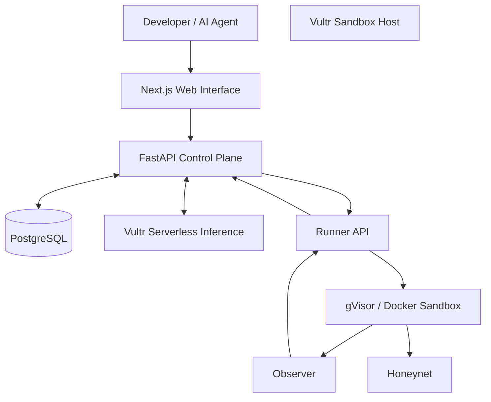

# Airlock

### Trust the evidence. Not the README.

Airlock is a containment-first security gateway that analyzes untrusted code before developers or AI agents execute it.

Instead of trusting package descriptions, comments, or README files, Airlock observes what code actually does inside an isolated sandbox and returns an evidence-based security verdict.

**Project:** Vultr: Agent Rush Hackathon  
**Track:** Challenge 1 — Blast Radius Zero  
**Category:** AI Security / Developer Tools  
**Demo:** http://192.248.179.127/

---

## The Problem

Developers regularly execute unfamiliar scripts, install third-party packages, and use AI-generated code.

The problem is simple: code can claim to be harmless while performing unexpected actions.

Traditional code inspection cannot always reveal runtime behavior.

Airlock addresses this problem by creating a controlled environment where untrusted code can be analyzed without giving it access to the application runtime or real credentials.

## How Airlock Works

Airlock follows six main stages:

1. **Fetch** — validates and prepares the submitted artifact.
2. **Plan** — the AI Planner analyzes static information and prepares an experiment.
3. **Run** — a trusted harness executes inside an isolated sandbox.
4. **Observe** — the Observer collects runtime events.
5. **Verify** — deterministic rules evaluate the collected evidence.
6. **Verdict** — the Explainer produces a readable security report.

The result is an evidence-based verdict rather than a decision based only on AI-generated text.

## Key Features

- **Isolated Execution:** Docker containers using the gVisor runtime (`runsc`).
- **Canary Detection:** Synthetic credential files help identify suspicious file access.
- **Network Containment:** An isolated Honeynet intercepts and records outbound attempts.
- **Runtime Observation:** Host-side monitoring collects file, process, network, and resource events.
- **Resource Limits:** CPU, memory, process, disk, and execution-time restrictions.
- **Evidence-Based Verdicts:** Deterministic rules classify observed behavior.
- **Claim vs. Behavior:** Compares the artifact's stated purpose with its observed actions.
- **Integrity Receipts:** SHA-256 hashing and HMAC-based signing for run manifests.
- **Live Timeline:** Displays execution stages and security events in the web interface.

## Security Verdicts

| Verdict | Meaning |
|---|---|
| SAFE_OBSERVED | No suspicious behavior was detected in the observed execution |
| SUSPICIOUS | One or more suspicious behaviors were detected |
| MALICIOUS | Evidence of credential-related exfiltration behavior was detected |
| ERROR | A valid analysis result could not be established |

A SAFE_OBSERVED result does not guarantee that code is completely safe. It only describes the behavior observed during the tested execution.

## Architecture

Airlock separates application management from untrusted code execution.



### Infrastructure

**VM #1 — Control Plane**
- Next.js frontend
- FastAPI backend
- Orchestrator
- PostgreSQL
- Vultr Serverless Inference integration
- Receipt service

**VM #2 — Sandbox Host**
- Docker
- gVisor (`runsc`)
- Runner API
- Host-side Observer
- Isolated Honeynet

The Runner communicates with the Control Plane through an authenticated API. Inference and Vultr credentials are kept outside the sandbox.

## Technology Stack

| Component | Technology |
|---|---|
| Frontend | Next.js, React, TypeScript |
| Backend | Python, FastAPI |
| Database | PostgreSQL |
| AI | Vultr Serverless Inference |
| AI integration | OpenAI-compatible API |
| Execution | Docker |
| Isolation | gVisor |
| Observation | Host-side runtime telemetry |
| Network containment | Docker internal network, Honeynet |
| Infrastructure | Vultr Cloud Compute |
| Deployment | Docker Compose, Caddy |

## Demonstration Samples

Airlock includes controlled test fixtures designed to demonstrate different runtime behaviors.

| Sample | Purpose |
|---|---|
| Benign CSV Tool | Demonstrates ordinary behavior |
| Evil Installer | Demonstrates canary access and blocked outbound attempts |
| README Lies | Demonstrates differences between declared and observed behavior |
| Injection README | Tests resistance to instructions embedded in untrusted content |
| Fork Bomb | Demonstrates process resource restrictions |
| Memory Hog | Demonstrates memory limits |

All demonstration samples are team-created test fixtures. Canary credentials are synthetic and do not represent real user secrets.

## Containment & Security

Airlock addresses the four containment focus areas of the hackathon.

**Process Isolation**
- Separate sandbox host.
- gVisor runtime.
- Non-root execution.
- Read-only root filesystem.
- Dropped Linux capabilities.
- No-new-privileges security setting.

**Secret Hygiene**
- Inference and Vultr credentials remain on the Control Plane.
- Sandbox environments receive synthetic canary data.
- Sensitive environment variables are excluded from sandbox execution.

**Resource Limits**
- CPU restrictions.
- Memory limits.
- PID limits.
- Disk restrictions.
- Execution timeout.

**Lifecycle Discipline**
- Disposable container per run.
- Cleanup after execution.
- Cleanup after errors and manual termination.
- Orphan resource cleanup through the infrastructure manager.

These controls depend on the live Runner configuration. The runtime health check must confirm gVisor observation before a run is accepted.

## Current Scope

The current MVP focuses on predefined samples, source submission, ZIP uploads, sandbox execution, runtime observation, and evidence-based reporting.

Direct npm registry fetching is not enabled in the current deployment contract.

Burn-after-run VM provisioning depends on Vultr API configuration and is not required for the standard sandbox workflow.

The receipt functionality currently provides an integrity artifact; a complete independent second-sandbox re-verification workflow is not part of the confirmed MVP.

## Running the Project

### Prerequisites

- Ubuntu-based Vultr Cloud Compute instances
- Docker and Docker Compose
- Python 3
- Node.js 22.12+
- A Vultr Serverless Inference API key
- Configured private networking between the Control Plane and Sandbox Host

### Deployment

The repository contains separate deployment scripts for the two infrastructure layers:

- `infra/vm2_setup.sh` — prepares the Sandbox Host.
- `infra/vm1_deploy.sh` — deploys the Control Plane.

Configure the required environment variables and secrets securely before deployment. Never commit `.env` files, API keys, or Runner tokens.

The main infrastructure configuration is located in:

```text
infra/
  compose.vm1.yml
  vm1_deploy.sh
  vm2_setup.sh
  network_guard.sh
  Caddyfile
  CONTAINMENT_REPORT.md
  RECOVERY.md
```

### Testing

The repository includes automated tests covering:

- Backend API behavior
- Verdict evaluation
- Event contracts
- Runner lifecycle
- Canary detection
- Runtime observation
- Containment boundaries
- Vultr infrastructure integration

Run the relevant test suites in an appropriately isolated development environment.

## Project Vision

Airlock aims to become a security gateway between developers, AI agents, and untrusted code.

Future development directions include:
- GitHub Actions and CI/CD integration.
- MCP integration for coding agents.
- Expanded artifact and package support.
- Independent verification workflows.
- Stronger execution isolation and audit capabilities.

## Why Airlock?

A README describes what code claims to do.

Airlock observes what it actually does.

**Airlock — Trust the evidence. Not the README.**
